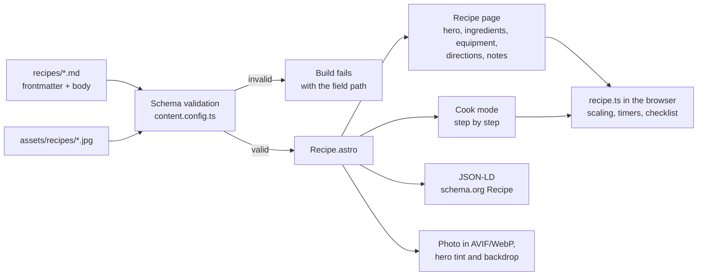
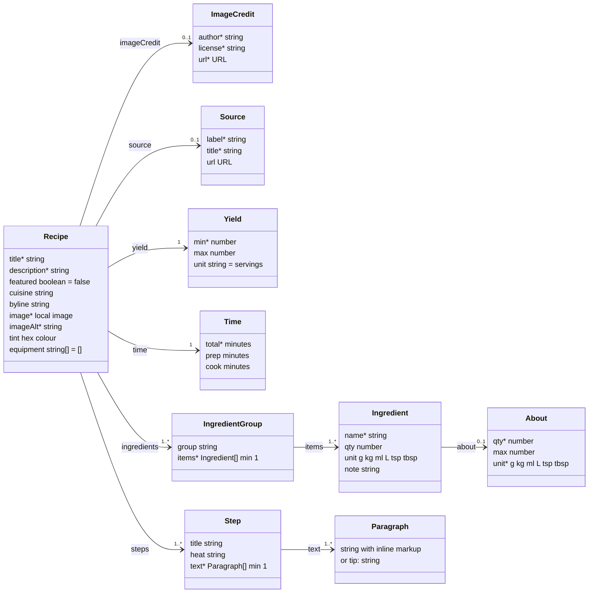
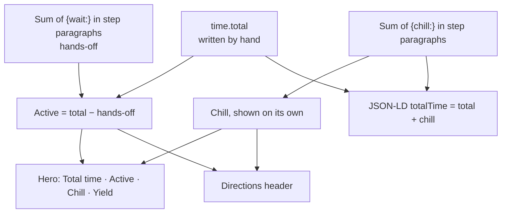

# The recipe model

What a soowee recipe contains, how each part is defined, what is required, and what the site derives from it.

The source of truth is the schema in [`src/content.config.ts`](../src/content.config.ts); this document explains it. A test (`src/lib/docs.test.ts`) fails when a schema field is missing here, so the two cannot quietly drift apart.

- [Overview](#overview)
- [Data model](#data-model)
- [Field reference](#field-reference)
- [Inline markup in steps](#inline-markup-in-steps)
- [Time](#time)
- [Scaling](#scaling)
- [Validation rules](#validation-rules)
- [Notes in the Markdown body](#notes-in-the-markdown-body)
- [Writing conventions](#writing-conventions)
- [Examples](#examples)
- [Open decisions](#open-decisions)

## Overview

One recipe is one Markdown file in `src/content/recipes/`. The file name is the URL: `tiramisu.md` becomes `/tiramisu/`.

- **Frontmatter** (the YAML between the `---` lines) holds the structured data: everything that is scaled, timed, validated or exported.
- **Body** (the Markdown after the frontmatter) holds free-form notes: chef’s notes, allergens, the source. It is shown below the directions and is not validated.



The home page (`/`) has no gallery yet: it redirects to the first recipe with `featured: true`, or to the first recipe if none is featured.

## Data model

Fields marked `*` are required. Everything else is optional.



## Field reference

### Recipe

| Field | Type | Required | Default | Rules | Shown |
|---|---|---|---|---|---|
| `title` | text | yes | | | Hero heading, browser tab, cook mode, JSON-LD `name` |
| `description` | text | yes | | One or two sentences | Lede under the hero, meta description, social preview, JSON-LD |
| `featured` | true/false | no | `false` | | The home page redirects to the first featured recipe |
| `cuisine` | text | no | | e.g. `Italian`, `British` | Small label above the title, JSON-LD `recipeCuisine` |
| `byline` | text | no | | Currently used for origin: `Adapted from Vincenzo’s Plate` | Under the title |
| `image` | path | yes | | Relative path to a local image; by convention in `src/assets/recipes/` | Hero photo (AVIF/WebP, 480–2560 px), source-card thumbnail, social preview; the hero colour and the blurred backdrop are computed from it |
| `imageAlt` | text | yes | | Describe what is in the photo | Alt text of the hero photo |
| `imageCredit` | object | no | | See [Image credit](#image-credit) | Footer: “Photo: author, license” |
| `tint` | text | no | from the photo | `#rrggbb` | Overrides the hero colour |
| `source` | object | no | | See [Source](#source) | Card in the hero, a link if it has a `url` |
| `yield` | object | yes | | See [Yield](#yield) | Hero, ingredients header, JSON-LD; scales |
| `time` | object | yes | | See [Time](#time) | Hero, directions header, JSON-LD |
| `ingredients` | list of groups | yes | | At least one group | Ingredients list, cook-mode ingredients tab, JSON-LD |
| `equipment` | list of text | no | `[]` | One item per line: `Fine-mesh sieve, for dusting cocoa` | Equipment section; hidden when empty |
| `steps` | list | yes | | At least one step | Directions, cook mode, JSON-LD |

### Image credit

All three fields are required when `imageCredit` is present. Photos are licensed images (Unsplash, Wikimedia Commons), never the original recipe author’s.

| Field | Type | Rules |
|---|---|---|
| `author` | text | As the licence asks for it |
| `license` | text | e.g. `Unsplash License`, `CC BY-SA 4.0` |
| `url` | URL | The photo’s page, not the image file |

### Source

| Field | Type | Required | Rules |
|---|---|---|---|
| `label` | text | yes | Small caps line on the card, e.g. `Original recipe` |
| `title` | text | yes | e.g. `Vincenzo’s Plate: Authentic Tiramisu` |
| `url` | URL | no | Without it the card is not a link |

### Yield

| Field | Type | Required | Default | Rules |
|---|---|---|---|---|
| `min` | number | yes | | Positive |
| `max` | number | no | | For a range: `8–10 servings` |
| `unit` | text | no | `servings` | e.g. `pieces` |

### Ingredient groups

| Field | Type | Required | Rules |
|---|---|---|---|
| `group` | text | no | The part of the dish: `For the cream`. Leave out for a recipe with one group |
| `items` | list of ingredients | yes | At least one |

### Ingredient

Written as a YAML flow mapping, one per line: `- { qty: 750, unit: g, name: mascarpone }`.

| Field | Type | Required | Rules | Example |
|---|---|---|---|---|
| `name` | text | yes | What you shop for, name first | `mascarpone`, `onion`, `mozzarella fior di latte` |
| `qty` | number | no | Positive. Leave out for “a pinch”, “to taste”, “for dusting” | `750`, `1.5` |
| `unit` | unit | no | One of `g`, `kg`, `ml`, `L`, `tsp`, `tbsp`. Leave out for counted things | `g` |
| `about` | object | no | Approximate weight or volume of something counted in pieces. See below | `{ qty: 150, unit: g }` |
| `note` | text | no | Size, cut, kind or use, shown after the name in a lighter tone. Does **not** scale | `medium, diced into small cubes` |

`about` exists because a weight written in `note` would not scale.

| Field | Type | Required | Rules |
|---|---|---|---|
| `qty` | number | yes | Positive |
| `max` | number | no | For a range; must be larger than `qty` |
| `unit` | unit | yes | Same list as `unit` above |

Rendered as `36 Savoiardi biscuits (about 300–360 g), ladyfingers, half for each layer`.

The units are metric only, by design. Imperial is an [open decision](#open-decisions).

### Step

| Field | Type | Required | Rules |
|---|---|---|---|
| `title` | text | no | Short, imperative: `Make the cream` |
| `heat` | text with inline markup | no | Oven or oil to get hot, e.g. `Preheat the **oven** to **180 °C**`. Shown first in the step with a thermometer icon and highlighted, so it is started in time |
| `text` | list of paragraphs | yes | At least one. A paragraph is either text with [inline markup](#inline-markup-in-steps) or a `tip`, written `- tip: …` |

A step needs at least one line that is not a tip (`heat` or a text paragraph), because cook mode lands on those lines.

## Inline markup in steps

Allowed in `heat`, step paragraphs and tips. Raw HTML is escaped, not rendered.

| Markup | Meaning | Rendered as | Scales | Counts towards |
|---|---|---|---|---|
| `**mascarpone**` | Ingredient mention | Bold | | |
| `{750 g}`, `{2 tbsp}`, `{6}` | Amount used at this point (not the ingredient total) | `750 g` | yes | |
| `{timer:20m}`, `{timer:5-10m}` | Something to check on | Tappable timer, label `5–10 minutes`; a range rings at its lower bound | | Active time |
| `{wait:1h}` | Hands-off time: simmering, baking, resting | Tappable timer, like `{timer:}` | | Hands-off time |
| `{chill:8h}` | Minimum time in the fridge before serving | Plain text `8 hours`, not a timer | | Chilling, outside the total |
| `tip: …` | A callout between paragraphs | Bulb icon; “Tip:” for screen readers | | |

Durations are written as `45s`, `20m`, `1h`, `1h30m` or a range `5-10m`. The label is generated (“1 hour 30 minutes”), so durations read the same everywhere; write the sentence around it: “bake for {timer:10m} more”. Amount units must be from the unit list; an unknown unit fails the build.

Only step paragraphs count towards time: a `{wait:}` or `{chill:}` inside `heat` or a tip is shown but not counted.

## Time

All times are whole minutes.

| Field under `time` | Required | Meaning |
|---|---|---|
| `total` | yes | Start to finish, **including** `{wait:}` time and **excluding** `{chill:}` time |
| `prep` | no | In the Directions header only, and only when the recipe has no `{wait:}` timers (never in the hero); always in JSON-LD as `prepTime` |
| `cook` | no | Same as `prep`; JSON-LD `cookTime` |

Not checked: that `prep + cook` equals `total`.

The rest is derived:



| The recipe has | Hero | Directions header |
|---|---|---|
| No `{wait:}`, no `{chill:}` | Total time | `Total Time: 1 hr (Prep 20 min, Cook 40 min)`; without `prep`/`cook` just `Total Time: 1 hr` |
| `{wait:}` | Total time, Active | `Total Time: 4 hr 30 min (1 hr 25 min active, 3 hr 5 min hands-off)`; `prep`/`cook` are not shown |
| `{chill:}`, no `{wait:}` | Total time, Chill `+8 hr` | `Total Time: 30 min, plus 8 hr chilling`; with `prep`/`cook`: `Total Time: 30 min (Prep 10 min, Cook 20 min), plus 8 hr chilling` |
| `{wait:}` and `{chill:}` | Total time, Active, Chill | `Total Time: … (… active, … hands-off), plus … chilling` |

How the sums are made:

- A range counts at its **lower bound**: `{wait:20-25m}` adds 20 minutes, `{chill:8-12h}` reads “8–12 hours” but adds 8 hours. Write `time.total` with the same lower bounds, or the active time comes out too long.
- The sums are rounded to whole minutes, so waits shorter than 30 seconds in total count as no wait at all.

`{chill:}` is for time after the dish is finished, when it only has to set (tiramisu, terrines). A rest the cook has to plan around before serving, like resting a lasagna, is `{wait:}`.

## Scaling

The reader can scale a recipe to ½×, 1×, 1½×, 2×, 3× or 4×. The choice and the ticked-off ingredients survive a reload for the visit (session storage). Running timers survive a reload too, and saved recipes and the light/dark choice are kept across visits (local storage).

| Scales | Does not scale |
|---|---|
| Ingredient `qty` | `note` |
| `about.qty` and `about.max` | `equipment` |
| `{amount}` in steps, `heat` and tips | Numbers written as plain text (“1–2 seconds”, “180 °C”) |
| `yield` | Times |

Every scaled value is rounded independently:

- `g` and `ml`: whole numbers, to the nearest 5 from 100 up (750 × 1.5 = 1125), and one decimal below 1 (1 g at ½× reads 0.5 g).
- `kg` and `L`: up to two decimals, trailing zeros dropped.
- Everything else (counts, `tsp`, `tbsp`, yield): the nearest of ⅛, ¼, ⅓, ⅜, ½, ⅝, ⅔, ¾ and ⅞; anything that would round to nothing reads ⅛.

So a split amount can drift from its total at some scales: 15 g + 15 g of a 30 g ingredient reads 8 g + 8 g at ½×.

## Validation rules

The build fails in two places.

**Schema validation**, with the recipe file and the field path, when:

- a required field is missing, or a value has the wrong type;
- an ingredient or `about` `unit` is not in the unit list;
- `qty`, `about.qty`, `about.max` or a `yield` number is zero or negative, or `about.max` is not larger than `about.qty`;
- `time` values are not positive whole minutes, or `{wait:}` timers add up to `time.total` or more (there would be no active time left);
- a `{chill:}` duration in a step paragraph is malformed (`{chill:overnight}`);
- a step has only tips and no `heat`;
- `tint` is not a `#rrggbb` colour, or a URL is not a URL;
- the `image` file does not exist.

**Rendering the page**, with the broken token in the message but without a field path, when:

- an inline amount has a unit outside the unit list (`{2 cups}`);
- a `{timer:}` duration is malformed, or any duration token in `heat` or a tip is;
- a `{wait:}` duration is malformed (it is read during schema validation, but the error is thrown as it is rather than reported against a field).

Not checked, so it is up to the author:

- **unknown keys**: a misspelt optional field (`cusine:`) is silently dropped, not reported;
- that `yield.max` is larger than `yield.min`;
- that every ingredient in the list is used in the steps, and the other way round;
- that amounts split across steps add up to the ingredient total;
- that `time.total` matches the method.

## Notes in the Markdown body

Free Markdown after the frontmatter, shown as a “Notes” section below the directions. It is not part of the scaled or validated data and not in JSON-LD.

Sections in use:

| Heading | Content |
|---|---|
| `## Chef’s Notes` | Make ahead, storage, what to serve with it |
| `## Allergens` | One bullet per allergen with where it comes from |
| `## Source` | “Adapted from [title](url).”, plus a video link if there is one |

The existing recipes do not all follow this yet (Fish & Chips uses “Chef’s Tips”, “Serving Suggestions” and “Allergen Warnings”). See [Open decisions](#open-decisions).

## Writing conventions

- **Bold** every ingredient from the list in the step where it is used, every time. Intermediate preparations (egg whites, the cream, the ragù) are not bold. Tips that only mention an ingredient leave it plain.
- Ingredient `name` comes first, qualifiers go in `note`: `onion` + `medium, diced into small cubes`, not `medium diced onion`.
- Quote a `note` that contains a comma: `note: "large, separated"`. Unquoted, YAML cuts the note at the comma and the rest is silently dropped.
- Typographic apostrophes and quotes: `Chef’s`, `Vincenzo’s`.
- Sensory cues next to times: “until pale, thick and creamy”, not only “for 5 minutes”.
- English, metric units, `°C`.

## Examples

Minimal valid recipe:

```yaml
---
title: Toast
description: Crisp bread with butter.
image: ../../assets/recipes/toast.jpg
imageAlt: Two slices of buttered toast on a plate
yield:
  min: 1
time:
  total: 5
ingredients:
  - items:
      - { qty: 2, name: slices of bread }
      - { qty: 10, unit: g, name: butter }
steps:
  - text:
      - Toast {2} **slices of bread** for {timer:2-3m}, until golden, and spread with {10 g} **butter**.
---
```

For a full recipe with groups, `about`, `heat`, tips, `{wait:}` and `{chill:}`, see [`lasagna.md`](../src/content/recipes/lasagna.md) and [`tiramisu.md`](../src/content/recipes/tiramisu.md).

## Open decisions

Not decided yet; listed so they are not lost. None of them exists in the code today.

| Topic | Today | Option |
|---|---|---|
| Unit system | Metric only | Metric stays the default. A reader toggle to imperial later needs conversions for `g`/`ml` and a decision on `tsp`/`tbsp` (already shared) and on oven temperatures, which are plain text today |
| `byline` | Used for the recipe’s origin (“Adapted from …”) | Decide whether it is the author, the origin, or both, and whether origin moves to `source` |
| Size and preparation | Both in `note`: `medium, diced into small cubes` | Separate `size` and `prep` fields for a consistent order |
| Heat | Free text; the temperature is bold text | A structured temperature (`temp: 180`), needed for a °F toggle and a preheat timer |
| Amounts in steps | `{25 g}` scales but is not linked to an ingredient | Link step amounts to list ingredients, so the build can check that splits add up and every ingredient is used |
| Body sections | Free Markdown with different headings per recipe | Fixed headings, or structured fields for allergens, serving suggestions and variations |
| Strict schema | Unknown frontmatter keys are silently dropped | Reject unknown keys, so a typo in an optional field fails the build |
