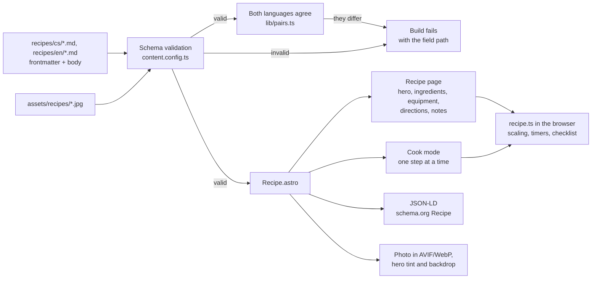
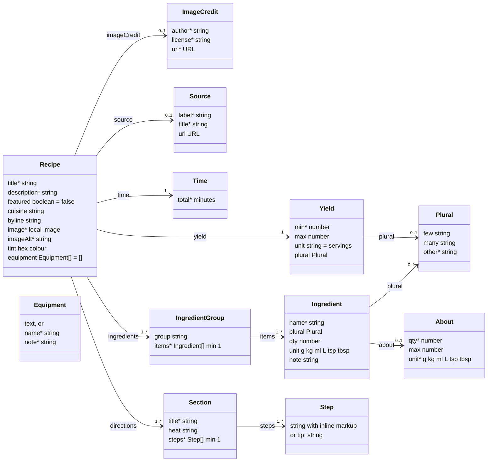
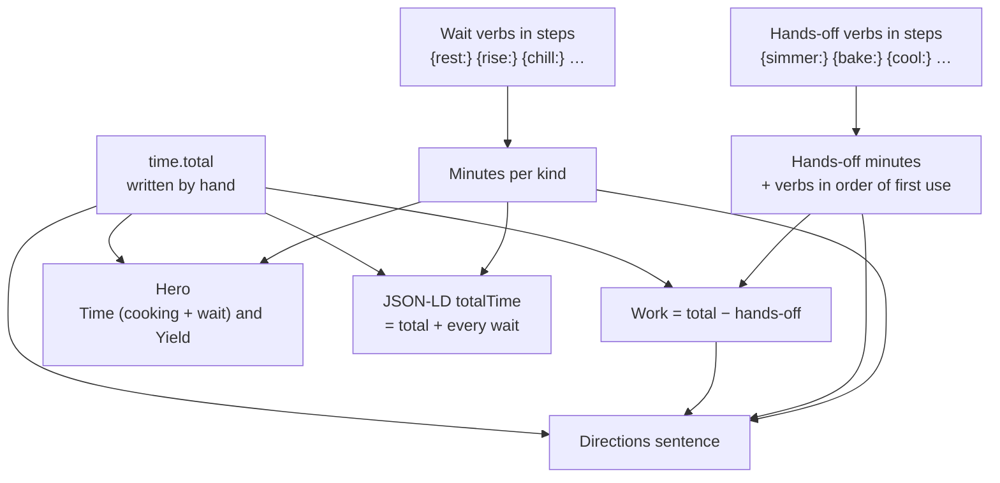

# The recipe model

What a soowee recipe contains, how each part is defined, what is required, and what the site derives from it.

The source of truth is the schema in [`src/content.config.ts`](../src/content.config.ts); this document explains it. A test (`src/lib/docs.test.ts`) fails when a schema field is missing here, so the two cannot quietly drift apart.

- [Overview](#overview)
- [Data model](#data-model)
- [Field reference](#field-reference)
- [Inline markup in steps](#inline-markup-in-steps)
- [Time](#time)
- [Scaling](#scaling)
- [Validation rules](#validation-rules)
- [Notes in the Markdown body](#notes-in-the-markdown-body)
- [Writing conventions](#writing-conventions)
- [Languages](#languages)
- [Examples](#examples)
- [Open decisions](#open-decisions)

## Overview

One recipe is one Markdown file per language: `src/content/recipes/cs/tiramisu.md` and `src/content/recipes/en/tiramisu.md`. The file name is the URL and the same in both languages: Czech is the default at `/tiramisu/`, English at `/en/tiramisu/`. Both versions tell the same recipe and only their words differ: see [Languages](#languages).

- **Frontmatter** (the YAML between the `---` lines) holds the structured data: everything that is scaled, timed, validated or exported.
- **Body** (the Markdown after the frontmatter) holds the notes under three fixed headings: chef’s notes, allergens and, optionally, the source. It is shown below the directions; its text is free, only the headings are checked.



The home page (`/`, `/en/`) lists every recipe of its language with search. The recipe with `featured: true` leads it as a large card; at most one recipe can be featured (the build fails otherwise), and with none the page simply starts with the list.

## Data model

Fields marked `*` are required. Everything else is optional.



## Field reference

### Recipe

| Field | Type | Required | Default | Rules | Shown |
|---|---|---|---|---|---|
| `title` | text | yes | | | Hero heading, browser tab, cook mode, JSON-LD `name` |
| `description` | text | yes | | One to three sentences | Lede under the hero, home page list (cut to 3 lines on phones), meta description, social preview, JSON-LD |
| `featured` | true/false | no | `false` | At most one recipe | Shown large at the top of the home page, instead of in its list (it joins the list only as a search result) |
| `cuisine` | text | no | | e.g. `Italian`, `British` | Small label above the title, JSON-LD `recipeCuisine` |
| `byline` | text | no | | Currently used for origin: `Adapted from Vincenzo’s Plate` | Under the title |
| `image` | path | yes | | Relative path to a local image; by convention in `src/assets/recipes/` | Hero photo (AVIF/WebP, 480–2560 px), source-card thumbnail, social preview; the hero colour and the blurred backdrop are computed from it |
| `imageAlt` | text | yes | | Describe what is in the photo | Alt text of the hero photo |
| `imageCredit` | object | no | | See [Image credit](#image-credit) | Footer: “Photo: author, license” |
| `tint` | text | no | from the photo | `#rrggbb` | Overrides the hero colour |
| `source` | object | no | | See [Source](#source) | Card in the hero, a link if it has a `url` |
| `yield` | object | yes | | See [Yield](#yield) | Hero, ingredients header, JSON-LD; scales |
| `time` | object | yes | | See [Time](#time) | Hero, directions header, JSON-LD |
| `ingredients` | list of groups | yes | | At least one group | Ingredients list, cook-mode ingredients tab, JSON-LD |
| `equipment` | list | no | `[]` | One item per line: a name (`Fine-mesh sieve`), or a name with its size or use in `note`: `{ name: Crêpe pan, note: "⌀ 28 cm" }` | Equipment section, the note after the name in a lighter tone, like an ingredient's; hidden when empty |
| `directions` | list of sections | yes | | At least one section. See [Directions](#directions) | Directions, cook mode, JSON-LD |

### Image credit

All three fields are required when `imageCredit` is present. Use licensed images (Unsplash, Wikimedia Commons), not the original recipe author’s photos, unless the owner explicitly supplies and approves a photo. An owner-approved photo with an unknown source may omit `imageCredit`; never invent an author, licence or source URL.

| Field | Type | Rules |
|---|---|---|
| `author` | text | As the licence asks for it |
| `license` | text | e.g. `Unsplash License`, `CC BY-SA 4.0` |
| `url` | URL | The photo’s page, not the image file |

### Source

| Field | Type | Required | Rules |
|---|---|---|---|
| `label` | text | yes | Small caps line on the card, e.g. `Original recipe` |
| `title` | text | yes | e.g. `Vincenzo’s Plate: Authentic Tiramisu` |
| `url` | URL | no | Without it the card is not a link |

### Yield

| Field | Type | Required | Default | Rules |
|---|---|---|---|---|
| `min` | number | yes | | Positive |
| `max` | number | no | | For a range: `8–10 servings` |
| `unit` | text | no | `servings` (`porce`) | What is counted, in the form for 1: `crêpe`, `palačinka`. Leave out for servings |
| `plural` | object | with `unit` | | The unit's other forms, see [Plural](#plural): `{ other: crêpes }` |

### Ingredient groups

| Field | Type | Required | Rules |
|---|---|---|---|
| `group` | text | no | The part of the dish: `For the cream`. Leave out for a recipe with one group |
| `items` | list of ingredients | yes | At least one |

### Ingredient

Written as a YAML flow mapping, one per line: `- { qty: 750, unit: g, name: mascarpone }`.

| Field | Type | Required | Rules | Example |
|---|---|---|---|---|
| `name` | text | yes | What you shop for, name first, written as it reads after the amount: the form for 1 when counted (`egg`, `citron`), and in Czech the genitive after a unit (`35 g másla`). Steps refer to it by this name or one of its forms: see [Ingredient mentions](#ingredient-mentions) | `mascarpone`, `onion`, `hladké mouky` |
| `plural` | object | when counted | The name's other forms, required for something counted in pieces (a `qty` and no `unit`), so “1 lemon” scales to “2 lemons”. See [Plural](#plural) | `{ other: eggs }` |
| `qty` | number | no | Positive. Leave out for “a pinch”, “to taste”, “for dusting” | `750`, `1.5` |
| `unit` | unit | no | One of `g`, `kg`, `ml`, `L`, `tsp`, `tbsp`. Leave out for counted things | `g` |
| `about` | object | no | Approximate weight or volume of something counted in pieces. See below | `{ qty: 150, unit: g }` |
| `note` | text | no | Size, cut, kind or use, shown after the name in a lighter tone. Does **not** scale | `medium, diced into small cubes` |

`about` exists because a weight written in `note` would not scale.

| Field | Type | Required | Rules |
|---|---|---|---|
| `qty` | number | yes | Positive |
| `max` | number | no | For a range; must be larger than `qty` |
| `unit` | unit | yes | Same list as `unit` above |

Rendered as `36 Savoiardi biscuits (about 300–360 g), ladyfingers, half for each layer`.

### Plural

A noun that follows a number which scales (a counted ingredient, the yield unit) needs a form for every number, or a scaled recipe would read “2 lemon”. The noun itself is the form for 1; `plural` gives the others, named by the plural categories `Intl.PluralRules` uses. Each language needs exactly its own; the build fails on a missing or a foreign one.

| Field | Type | Required | Rules | English | Czech |
|---|---|---|---|---|---|
| `few` | text | Czech | 2, 3, 4 | | `citrony`, `vejce` |
| `many` | text | Czech | Fractions: ½, 1½ | | `citronu`, `vejce` |
| `other` | text | yes | English: every number but 1. Czech: 0 and 5 and more | `lemons` | `citronů`, `vajec` |

```yaml
- { qty: 1, name: lemon, plural: { other: lemons }, note: "cut into wedges" }
- { qty: 1, name: citron, plural: { few: citrony, many: citronu, other: citronů }, note: "na měsíčky" }
```

English uses the singular up to 1, so a fraction reads “½ lemon”. Units follow the same rules without any markup: Czech spells the spoons out (`1 lžíce`, `5 lžic`, `½ lžičky`) and writes `l` for litres. In a step a spoon for 1 is in the accusative, as the object of the verb: “přidejte {1 tbsp …}” reads “přidejte 1 lžíci …”.

The units are metric only, by design. Imperial is an [open decision](#open-decisions).

### Directions

The method has two levels, with one name each, used the same way in the YAML, the code, the page and this document:

- A **section** is a phase of the dish with a title: `Make the béchamel`. On the page its title is the heading; in cook mode it stays above the text.
- A **step** is one action the cook does, ending in a state they can check. It is one paragraph on the page and one stop in cook mode.
- A **tip** belongs to the step before it and is shown with that step.

This is the shape schema.org uses too: each section becomes a `HowToSection`, each step and `heat` line a `HowToStep`. Tips are left out of JSON-LD.

```yaml
directions:
  - title: Make the béchamel
    heat: Preheat the oven to **180 °C**, conventional top and bottom heat.
    steps:
      - Melt {40 g butter} in a saucepan over low heat.
      - Whisk in {40 g flour} and cook for {timer:1-2m}, without letting it colour.
      - tip: The roux should smell of biscuits, not of raw flour.
```

| Field | Type | Required | Rules |
|---|---|---|---|
| `title` | text | yes | Short, imperative, naming what the section makes or does: `Make the cream`, `Fry the fish`. Unique within the recipe, since it also names the section’s timers |
| `heat` | text with inline markup | no | Oven or oil to get hot, e.g. `Preheat the **oven** to **180 °C**`. Shown first in the section with a thermometer icon and highlighted, so it is started in time. Its own stop in cook mode |
| `steps` | list | yes | At least one. Each entry is a step, text with [inline markup](#inline-markup-in-steps), or a `tip`, written `- tip: …`. The first entry is a step, because a tip belongs to the step before it |

## Inline markup in steps

Allowed in `heat`, steps and tips. Raw HTML is escaped, not rendered.

| Markup | Meaning | Rendered as | Scales | Counts towards |
|---|---|---|---|---|
| `{750 g mascarpone}`, `{6 eggs}` | An ingredient [measured out](#ingredient-mentions) at this point: amount, then the ingredient | `750 g` **mascarpone** | the amount | Its total in the list |
| `{cocoa powder}` | An ingredient used here, without an amount | **cocoa powder** | | |
| `{máslem\|máslo}` | A mention in a form the ingredient's `name` and `plural` don't cover (a Czech case): shown on the left, refers to the right | **máslem** | | |
| `{300 ml}`, `{2 tbsp}`, `{6}` | An amount not linked to an ingredient: an intermediate preparation (“{300 ml} ragù”) or a portion measured out earlier | `300 ml` | yes | |
| `**180 °C**` | Emphasis that is not an ingredient: the temperature in a `heat` line | Bold | | |
| `{timer:20m}`, `{timer:5-10m}` | Something the cook does or checks on | Tappable timer, label `5–10 minutes`; a range rings at its lower bound | | Work |
| `{simmer:1h}`, `{bake:30m}`, `{cool:15-20m}` … | Hands-off time while cooking: the dish works on its own, the cook stays in the process. One verb per kind, see [Hands-off verbs](#hands-off-verbs) | Tappable timer, like `{timer:}` | | Cooking time, not work |
| `{rest:1h}`, `{rise:2h}`, `{marinate:4h}` | A wait the cook can walk away from, see [Wait verbs](#wait-verbs) | Tappable timer, like `{timer:}` | | The wait, outside the cooking time |
| `{chill:8h}`, `{freeze:6h}` | A wait in the fridge or freezer, at least this long | Plain text `8 hours`, not a timer | | The wait, outside the cooking time |
| `tip: …` | A callout after its step | Bulb icon; “Tip:” for screen readers | | |

Durations are written as `45s`, `20m`, `1h`, `1h30m` or a range `5-10m`. The label is generated (“1 hour 30 minutes”), so durations read the same everywhere; write the sentence around it: “bake for {bake:10m} more”. Amount units must be from the unit list, and a token that is not in the lists (`{wait:1h}`, `{steam:5m}`) fails the build instead of being printed raw.

Use `{timer:}` when the cook is busy (stirring, frying, whisking) and a hands-off verb when they are free to do something else. A bake the cook has to watch closely is still `{bake:}`; the difference is only whether the time counts as work.

Only steps count towards time: a duration inside `heat` or a tip is shown, and validated, but not counted.

### Ingredient mentions

Steps name the ingredients of the list with `{…}`, so the build can check them against the list. Bold is only for emphasis, and an ingredient written in bold fails the build.

- **Which ingredient.** The text in the braces is the ingredient’s `name` or one of its [plural](#plural) forms, or whole words of them that fit only one ingredient: `{Provolone}` for `Provolone Piccante`, `{celery}` for `celery stick`, `{6 vajec}` for `vejce`. An English `-s` or `-es` plural is fine too: `{2 lemons}` for `lemon`. Any other form is written `{shown|name}`: “Vymažte formu {máslem|másla}”. A complete name wins over a partial one, so `{water}` is `water`, not `sparkling water`. Where a recipe has two salts, `{salt}` fails and the full name is needed. Lines with the same name in different groups are one ingredient.
- **Every ingredient is used.** Each ingredient of the list is mentioned at least once in a step or a `heat` line.
- **Measured once.** An amount inside the braces, `{250 g ground beef}`, is taken from the list at this point. For each ingredient these amounts add up exactly to its amount in the list (lines of the same name added together; `g` and `kg`, `ml` and `L` converted, spoons and counts only with themselves). A portion measured out earlier is mentioned with the amount on its own: “Grate {80 g Pecorino Romano} and set {30 g} aside”, later “the reserved {30 g} {Pecorino Romano}”. An amount added to taste is still written in: “adjust with up to {3 g salt}”. An ingredient mentioned only without an amount is used whole at that point, “Add the {onion}”, so nothing is added up; that is also how an ingredient without `qty` (“a pinch”) is mentioned.
- **Tips stay plain.** Tips mention ingredients in plain text, without `{…}` or bold, and their amounts (`{20 g}`) scale but do not count.

The rendered page looks the same either way: the amount scales and the ingredient is bold. A counted ingredient's name follows the scale too: the form written in the step is kept at its own number, the others come from `plural`, so “Nakrájejte {1 cibuli}” reads “2 cibule” at 2×. The rules are in [`src/lib/mentions.ts`](../src/lib/mentions.ts).

## Time

All times are whole minutes.

| Field under `time` | Required | Meaning |
|---|---|---|
| `total` | yes | The cooking time: start to finish of the cooking, **including** hands-off time (`{simmer:}`, `{bake:}` …) and **excluding** every wait (`{rest:}`, `{rise:}`, `{marinate:}`, `{chill:}`, `{freeze:}`) |

`total` is the only time written by hand. Everything else is derived from the duration tokens in the steps, so the page cannot show times that contradict the method. There is no separate prep time: it would be a second, unchecked source for the same thing.

### The rule: cooking time, then the wait

A cook plans in that order: how long does it take to make, and how long until we can eat? So every recipe splits its time the same way:

- **Cooking time** is everything the cook is in the process for: the work at the counter and the hands-off time in between (a ragù simmering, a lasagna baking, a cake cooling before it is iced). The cook can step away for a minute, but not leave.
- **The wait** is time the cook can walk away from: a batter resting, a dough rising, meat marinating, a tiramisu setting in the fridge. It can be in the middle of the method (crêpe batter) or at the end (tiramisu).

**Choosing the verb** decides which side a duration lands on. Ask: *can the cook leave the kitchen, or go to bed?* Yes → a wait verb. No → a hands-off verb, or `{timer:}` if they are busy.

### Terms

One vocabulary on every recipe:

| Term | Where | Meaning |
|---|---|---|
| **Time** | Hero: the cooking time, with the wait on a line under it (“30 min”, “+ 8 hr chilling”) | `time.total`, then the sum of the waits |
| **In total** | Directions sentence (“4 hr 30 min in total”) | The cooking time, when the recipe has no wait. With a wait it reads “of cooking”, since it is not the whole time |
| **Work** | Directions sentence (“1 hr 25 min of work”) | The part of the cooking time the cook is busy: total minus hands-off time |
| **Hands-off** | This document only | Time the dish works on its own while the cook stays in the process: the verbs below. Named by what happens (“simmering, baking”), never by this word on the page |
| **Wait** | This document only | Time the cook can walk away from, on top of the cooking time. Named by what happens (“resting”, “in the fridge”) |

The hero shows exactly two facts on every recipe, **Time** and **Yield**. The wait sits on its own line under the cooking time rather than in a third column: a third column wrapped onto a second row on narrow phones, and a line of its own reads second, after the cooking time, and never widens the row. A recipe without a wait shows only the cooking time. This follows the “25 minutes, plus 4 hours’ chilling” convention of NYT Cooking and America’s Test Kitchen, rather than a single total that hides how much of it is waiting.

### Hands-off verbs

Part of the cooking time. Each verb is a timer. The words in the second and third columns are used in the Directions sentence. To add one, add it to `HANDS_OFF` in [`src/lib/inline.ts`](../src/lib/inline.ts) and a row here (a test checks both). Czech bakes and roasts alike, so a recipe with both says “pečení” once.

| Token | In the sentence | Czech | Use for |
|---|---|---|---|
| `{simmer:}` | simmering | dušení | A sauce, stew or ragù cooking on its own |
| `{bake:}` | baking | pečení | Anything in the oven that is not a roast: lasagna, bread, cakes |
| `{roast:}` | roasting | pečení | Meat and vegetables in the oven |
| `{cool:}` | cooling | chladnutí | Cooling or settling at room temperature before the next step or before slicing: a cake before icing, a lasagna before it is cut |
| `{dry:}` | drying | osychání | Steam-drying, air-drying: parboiled chips on a rack |
| `{drain:}` | draining | odkapávání | Liquid running off: mozzarella, yoghurt, salted vegetables |
| `{soak:}` | soaking | namáčení | In water, as part of the method: potatoes, short soaks |

### Wait verbs

Outside the cooking time. The word in the second column is used in the hero (“+ 1 hr resting”) and, for waits without a place, in the Directions sentence (“1 hr of resting”). To add one, add it to `WAITS` in [`src/lib/inline.ts`](../src/lib/inline.ts) and a row here (a test checks both).

| Token | In the hero | Czech | Use for |
|---|---|---|---|
| `{rest:}` | resting | odležení | A batter or dough left to relax: crêpes, pastry. A timer |
| `{rise:}` | rising | kynutí | Yeast dough. A timer |
| `{marinate:}` | marinating | marinování | In a marinade. A timer |
| `{chill:}` | chilling | chlazení | In the fridge: setting a tiramisu or panna cotta, chilling a dough. Plain text, not a timer |
| `{freeze:}` | freezing | mražení | In the freezer: ice cream, semifreddo. Plain text, not a timer |

The fridge and the freezer are named by their place in the Directions sentence, with “at least”, because longer is fine there:

| Token | In the sentence | Czech |
|---|---|---|
| `{chill:}` | in the fridge | v lednici |
| `{freeze:}` | in the freezer | v mrazáku |

Meat resting for a few minutes before carving is part of serving, not a wait: write it as `{cool:}` or a `{timer:}`.

### How the times are derived



The hero and the sentence are built by `heroTime` and `describeTime` in [`src/lib/time.ts`](../src/lib/time.ts), with a unit test for every case below. JSON-LD is the one place where the waits are added to the cooking time, because schema.org’s `totalTime` means “until it can be served”.

### The Directions sentence

Generated, never written by hand. The numbers are bold. Czech follows the same table: “**4 h 30 min** celkem: **1 h 25 min** práce a **3 h 5 min** dušení a pečení.”, “**45 min** přípravy: **30 min** práce a **15 min** chladnutí, k tomu nejméně **4 h** v lednici.”

| The recipe has | Hero | Directions sentence |
|---|---|---|
| Only work | 25 min | **25 min** from start to finish. |
| Hands-off time | 4 hr 30 min | **4 hr 30 min** in total: **1 hr 25 min** of work and **3 hr 5 min** of simmering, baking and cooling. |
| A wait | 50 min<br/>+ 1 hr resting | **50 min** of work, plus **1 hr** of resting. |
| Fridge time | 30 min<br/>+ 8 hr chilling | **30 min** of work, plus at least **8 hr** in the fridge. |
| Both | 45 min<br/>+ 4 hr chilling | **45 min** of cooking: **30 min** of work and **15 min** of cooling, plus at least **4 hr** in the fridge. |
| Several waits | 40 min<br/>+ 8 hr rising and chilling | **40 min** of work, plus **2 hr** of rising and at least **6 hr** in the fridge. |

Rules:

- The verbs are listed in the order they first appear in the method, each once, joined as “a, b and c”. Waits follow the same rule, except that the fridge and then the freezer always come last.
- Hands-off time gets its own number instead of “the rest is …”, so the reader can see that work and hands-off time add up to the cooking time.
- The waits are joined with “plus”, never “then”: a wait can sit in the middle of the method.
- The hero adds the waits into one number, named by their verbs: “+ 8 hr rising and chilling”.
- “At least” is used only for the fridge and freezer, where longer is fine. A bake should not run longer.
- A day or more is written in days: `1 day 2 hr`.

How the sums are made:

- A range counts at its **lower bound**: `{bake:20-25m}` adds 20 minutes, `{chill:8-12h}` reads “8–12 hours” but adds 8 hours. Write `time.total` with the same lower bounds, or the work time comes out too long. The hero’s wait is the lower bound too: “+ 8 hr chilling” means at least 8 hours.
- The sums are made in seconds and rounded to whole minutes once, so hands-off time shorter than 30 seconds in total counts as none.

Known simplification: work done *during* hands-off time (making the béchamel while the ragù simmers) is not counted as work. Work is the time the recipe needs the cook at the counter, not every minute they spend in the kitchen.

## Scaling

The reader can scale a recipe to ½×, 1×, 1½×, 2×, 3× or 4×. The choice and the ticked-off ingredients survive a reload for the visit (session storage). Running timers survive a reload too, and saved recipes and the light/dark choice are kept across visits (local storage).

| Scales | Does not scale |
|---|---|
| Ingredient `qty` | `note` |
| `about.qty` and `about.max` | `equipment` |
| `{amount}` in steps, `heat` and tips | Numbers written as plain text (“1–2 seconds”, “180 °C”) |
| `yield` | Times |
| The nouns after those numbers: units and [plural](#plural) names | |

Every scaled value is rounded independently:

- `g` and `ml`: whole numbers, to the nearest 5 from 100 up (750 × 1.5 = 1125), and one decimal below 1 (1 g at ½× reads 0.5 g).
- `kg` and `L`: up to two decimals, trailing zeros dropped.
- Everything else (counts, `tsp`, `tbsp`, yield): the nearest of ⅛, ¼, ⅓, ⅜, ½, ⅝, ⅔, ¾ and ⅞; anything that would round to nothing reads ⅛.

So a split amount can drift from its total at some scales: 15 g + 15 g of a 30 g ingredient reads 8 g + 8 g at ½×.

## Validation rules

The build fails in two places, and `pnpm test` adds one more check.

**Schema validation**, with the recipe file and the field path, when:

- a required field is missing, or a value has the wrong type;
- a key is not part of the schema, at any level: a misspelt `cusine:` or an invented `time.prep` fails instead of being dropped;
- an ingredient or `about` `unit` is not in the unit list;
- `qty`, `about.qty`, `about.max` or a `yield` number is zero or negative, or `about.max` is not larger than `about.qty`;
- `time.total` is not a positive whole number of minutes, or the hands-off verbs add up to `time.total` or more (there would be no work left);
- any text of the method (`heat`, a step or a tip) has a malformed duration (`{chill:overnight}`), an unknown token (`{wait:1h}`) or a malformed amount (`{25gr}`); the path points to the exact line, e.g. `directions.3.steps.1`;
- a counted ingredient or a yield `unit` has no `plural`, or one with a form its language does not have (`few` in English), or something not counted has one;
- an [ingredient mention](#ingredient-mentions) fits no ingredient or more than one (`{2 cups}` fits none), an ingredient is never mentioned, the measured amounts of an ingredient do not add up to the list, an ingredient is written in bold, or a tip uses `{…}` for an ingredient;
- a section has no title, shares its title with another section, or its first entry is a tip;
- `tint` is not a `#rrggbb` colour, or a URL is not a URL;
- the `image` file does not exist.

**Comparing the languages** (`src/lib/recipes.ts` and `src/lib/pairs.ts`, on every build): every recipe must exist in both languages, and the two must agree on everything but its words: `featured`, the image, `tint`, the credit and source URLs, the yield numbers, `time.total`, how many items `equipment` has, every ingredient's `qty`, `unit` and `about` in the same groups and order, and every section's `heat`, steps and tips in the same order, with the same durations, amounts and numbers in each (in any order within one piece of text, `1.5` and `1,5` alike). The numbers in ingredient notes and equipment are compared too, and the notes must have the same sections, the same number of bullets and the same numbers in each section. Fractions written as glyphs count (`½`, `1½`); the digits in a link's address do not. Numbers written as words (“three additions”) are not checked, so write a number in the same form in both languages. The error names the first places that differ.

**Rendering the page** runs the token checks again on the same text, so in practice it only fails if schema validation was bypassed.

**`pnpm test`** also checks the [notes](#notes-in-the-markdown-body): only the fixed headings, in order, with the required ones present (`src/lib/notes.test.ts`).

Not checked, so it is up to the author:

- that `yield.max` is larger than `yield.min`;
- that an amount written outside the braces, or for an intermediate preparation, is right;
- that `time.total` matches the method.

## Notes in the Markdown body

Markdown after the frontmatter, shown as a “Notes” (“Poznámky”) section below the directions. It is not part of the scaled data and not in JSON-LD, but its sections are fixed so every recipe reads the same way: only these headings, in this order, each at most once.

| Heading | Czech | Required | Content |
|---|---|---|---|
| `## Chef’s Notes` | `## Poznámky šéfkuchaře` | yes | Labelled bullets: make ahead, store, swap, serve. See [Chef’s Notes](#chefs-notes) |
| `## Allergens` | `## Alergeny` | yes | One bullet per allergen from the EU list, with where it comes from, plus a swap if there is one. See [Allergens](#allergens) |
| `## Source` | `## Zdroj` | no | “Adapted from [title](url).”, plus a video link if there is one. Leave it out for your own recipes |

No other headings: storage, variations and serving suggestions are bullets in Chef’s Notes, not sections of their own, so the page stays short. `src/lib/notes.test.ts` enforces this.

## Writing conventions

### The reader

A home cook with basic craft who wants a restaurant-level result, not a shortcut. They own a scale and a thermometer, know how to dice an onion and what a simmer is, and will follow a two-hour ragù if it is worth it. So a recipe:

- explains the *why* of the steps that make the difference (browning in batches, a cold batter), never the basics;
- is precise where precision decides the result: weights, temperatures, a probe reading, a sensory cue;
- says what to buy when it matters (fior di latte, not bufala);
- stays lean. Every line has to earn its place, because a long recipe is harder to cook from, on the page and in cook mode. Guidance for someone cooking a dish for the first time is a separate idea in the [open decisions](#open-decisions), not a reason to add tips.

### Detail budget

| Part | Budget |
|---|---|
| `description` | One to three sentences: what the dish is and what makes this version worth it. Mention a commitment the reader must plan for (“Made a day ahead”). Lead with what helps someone choose: phones show only the first 3 lines on the home page. Not a list of every component, no filler (“featuring”, “delicious”) |
| Section | One phase of the dish, about 6 steps at most. Split a longer one where the cook could pause: “Brown the meat”, then “Simmer the ragù” |
| Step | One action, ending in a state the cook can check. Short enough to read at a glance from the stove: it should fit one cook-mode screen on a phone, together with its tip |
| Tip | At most two in a section, and most sections have none or one. A tip earns its place only if it adds one of: the *why* behind the step, how to tell it is going wrong, a choice at that point (a swap, what to buy), or a safety note. It never repeats its step |
| Equipment | Only what has a size or spec that matters, or what is not in every kitchen. Not knife, board, spoon, bowl or kitchen paper |
| Chef’s Notes | One bullet per label, see [Chef’s Notes](#chefs-notes) |

Planning (“start here”, “while the ragù simmers”) goes in a step as an instruction, not in a tip. A tip about the oven or the oil goes in that section’s `heat` line.

### Ingredients

- `name` comes first, qualifiers go in `note`: `onion` + `medium, finely chopped`, not `medium chopped onion`; `olive oil` + `extra virgin` (Czech `olivového oleje` + `extra panenského`).
- An ingredient appears at most once in a group. If it is used several times within the group, write the total and say how it splits in the `note`, without a lead-in like “in total”: `1 g with the vegetables, 8 g with the meat`. If it is used by several groups, each group lists its own amount.
- Use the measure the cook would reach for. Grams for what you weigh, `ml` or `L` for liquids, a count for eggs and other pieces. A spoon (`tsp`, `tbsp`, always level) where it is easier than the scale and precise enough: small amounts such as baking powder, spices, a little oil or lemon juice, and a ratio the cook can remember, like one tablespoon of sugar per egg. Grams where a spoon would be too rough: flour and sugar in baking, salt in a brine or a cure. Below 5 g, write a spoon or leave `qty` out and write `a pinch` in `note`, since few kitchen scales read that low.
- Something counted in pieces gets an `about` weight when its size changes the result: `1 onion (about 150 g)`.
- Quote a `note` that contains a comma: `note: "large, separated"`. Unquoted, YAML cuts the note at the comma and the rest is silently dropped.

### Sections, steps and tips

Where one ends and the next begins:

- **A new section** starts where the dish moves on to a new part (the ragù, the béchamel), a new place (from the hob to the oven) or a point where the cook could stop. The title says what comes out of it.
- **A new step** starts where the cook does something different. A step ends at a state they can check: a sensory cue (“until golden”), a temperature or a timer. A timer usually ends its step; a second one belongs in the same step only when it follows at once (“flip and cook the second side for {timer:15-20s}”).
- **Not a step:** a reason, a warning or a choice. That is a tip, after the step it concerns. A note on the oven or the oil is the `heat` line.
- Keep steps in the order the cook does them. Something done in parallel (“while the ragù simmers”) is said at the start of the step that is done meanwhile.

- Mention every ingredient from the list with `{…}` in the step where it is used, every time, with its amount where it is measured out: see [Ingredient mentions](#ingredient-mentions). Intermediate preparations (egg whites, the cream, the ragù), the oven and equipment are plain text. Tips mention ingredients in plain text.
- Sensory cues next to times: “until pale, thick and creamy”, not only “for 5 minutes”.
- An amount that should change when the recipe is scaled is an `{amount}`, never plain text: “spread {300 ml} ragù”, not “about 300 ml of ragù”.

### Equipment

- What it is goes in `name`, its size, material or use in `note`, as with ingredients: `{ name: Pot, note: "heavy-bottomed, 5 L" }`. Quote a note with a comma.
- Every dish, tin or pan that a bake or a set dessert takes its shape from has its inside size: `{ name: Baking dish, note: "30 × 20 cm" }`. A round pan's diameter is written with the sign: `⌀ 28 cm`. A pot gets its volume where it matters: `5 L`.
- Settings belong in the step, not in the list: the oven mode goes in the `heat` line.
- In the order of first use.

### Chef’s Notes

Bullets with a bold label, only these labels, in this order, each at most once and each optional. At least one.

| Label | Czech | Content |
|---|---|---|
| `**Make ahead:**` | `**Předem:**` | What can be done in advance, how far ahead, and how to finish it |
| `**Store:**` | `**Skladování:**` | Where and for how long: “keeps 3 days in the fridge”, plus how to reheat |
| `**Swap:**` | `**Obměny:**` | Substitutions and authentic variations: a different cheese, Marsala in a tiramisu |
| `**Serve:**` | `**Podávání:**` | What goes with it |

Technique belongs in the step it concerns, as a tip if the step does not already say it.

### Allergens

One bullet per allergen, named as in the EU list of 14, in this order: **Gluten**, **Crustaceans**, **Egg**, **Fish**, **Peanuts**, **Soy**, **Milk**, **Tree nuts**, **Celery**, **Mustard**, **Sesame**, **Sulphites**, **Lupin**, **Molluscs**. In Czech, by the short forms of the names in the Czech text of the EU list: **Lepek**, **Korýši**, **Vejce**, **Ryby**, **Arašídy**, **Sója**, **Mléko**, **Skořápkové plody**, **Celer**, **Hořčice**, **Sezam**, **Oxid siřičitý a siřičitany**, **Vlčí bob**, **Měkkýši**. Each lists the ingredients it comes from, plus a swap in one sentence if there is one: `- **Gluten:** flour and beer. Use gluten-free flour and beer.` Nothing else goes here: alcohol, for example, is a swap in Chef’s Notes, not an allergen.

### Text

- Typographic apostrophes and quotes: `Chef’s`, `Vincenzo’s`.
- An en dash for ranges in plain text, as the generated labels have: `2–3 minutes`, `60–63 °C`.
- Every step and tip ends with a full stop.
- Metric units, `°C`, with a space before the unit: `180 °C`, `1.5 cm` (Czech `1,5 cm`).

## Languages

Every recipe exists in Czech and in English: `src/content/recipes/cs/` and `src/content/recipes/en/`, one file each, with the same file name. Either can be written first; the other is a translation, and the build [compares them](#validation-rules) so a translation can never change the recipe. Everything that is not prose stays as it is in both: the keys, the units (`g`, `tbsp`), the tokens (`{simmer:20m}`) and the numbers in them, which keep a decimal point (`{1.5 kg}`). The page writes them out in the reader's language.

The rules below are the owner's decisions. Where they differ from an earlier review, a translation or a dictionary, they win.

### Translating a recipe

1. Read this document and an approved recipe in the target language as the model of tone and detail (`src/content/recipes/cs/crepes.md` for Czech).
2. Copy the source file's structure exactly: the same sections, the same steps and tips in the same places, the same `qty`, `unit`, `about`, durations, `{amount}` tokens and prose numbers. Write numbers as digits in both languages where the source does. Translate everything else.
3. Run `pnpm astro build`. It fails with the path of the line when a mention matches no ingredient, an amount or number differs from the other language, a plural form is missing, or a recipe exists in one language only.
4. Have the text read by an independent Czech editor (a person, or an agent given only this document and the two files), then apply the corrections.
5. The owner reviews a translation before it is published (AGENTS.md).

### The Czech voice

The voice of a contemporary Czech home cookbook (in the manner of Apetit or *Kuchařka pro dceru*): natural when read aloud, clear for someone standing at the stove, never a translation of the English.

- Address the reader in the polite plural and the imperative: “Rozpusťte máslo. Přilijte mléko. Těsto nechte odležet.”
- Keep the `description` short: what the dish is, what makes this version worth it, and what to plan for (“Těsto nechte alespoň hodinu odležet”).
- Section titles say what the cook does: “Umíchejte těsto”, “Nechte těsto odležet”, “Usmažte palačinky”.
- Steps follow the order of the work. When the vessel or the ingredient changes, name it, so the reader never has to look back a sentence.
- Pair a sensitive step's time with the sign the cook can see, smell or feel, in short sentences: “Smažte {timer:45-60s}. Povrch zmatní, tenký okraj zkřehne a začne se odchlipovat od pánve.” Use the signs the source gives.
- Put a condition where the reader acts on it: “Je-li těsto hustší, po lžících do něj zašlehejte až {50 ml plnotučného mléka}.” A tip holds a short reason, or what to do when something goes wrong.
- Pick the verb by the movement: dry ingredients *promíchejte*, eggs *rozšlehejte*, flour *zapracujte*, more liquid *vmíchejte*, the batter *přeceďte*; vegetables that must not brown *restujte*, until they *zesklovatí*.
- Heat in the general cookbook wording, whatever the hob, on one scale: low *mírný*, medium-low *mírný až střední*, medium *střední*, medium-high *středně silný*, high *silný*, the lowest *nejslabší* (“na **středně silném** ohni”, “zesilte ohřev”, “zmírněte ohřev”). Never “středně mírný”. Keep a specific setting where the recipe gives one.
- Italian and French terms that Czech cooks use stay as they are: *soffritto*, *ragù*, *passata*, *fior di latte*, *beurre noisette*. Use a foreign term where it helps the reader recognise an ingredient or a technique.
- A dish keeps the name Czech cooks know it by: *Palačinky*, *Boloňská omáčka*, *Lasagne*, but *Tiramisu*, *Fish & Chips*.

Turns that read as translated, and what to write instead:

| Translated | Czech cookbook |
|---|---|
| Prošlehejte mouku, cukr a sůl | V míse promíchejte mouku, cukr a sůl |
| Šlehejte, dokud ve vejcích nezůstanou bílé šmouhy | Vejce rozšlehejte, až se bílky spojí se žloutky |
| Na středně vysokém stupni | Na středně silném ohni |
| Kapka vody začne tančit | Kapka vody se rozběhne po dně |
| Spodní strana je místy dozlatova | Spodní strana místy zezlátne |
| Okraj začne krajkovitě křehnout | Tenký okraj zkřehne a začne se odchlipovat od pánve |
| Těsto má konzistenci tekuté smetany | Těsto má být řídké jako smetana |
| Najděte naběračku | Připravte si naběračku |
| Přestaňte, než ztmavne | Nenechte ho ztmavnout |
| Nechte vymíchat dohladka | Vymíchejte dohladka |
| Na prst vlažné | Na dotek vlažné |
| Přidejte plamen | Zesilte ohřev |
| Šlehače (the beaters) | Metly |
| Až olej začne třpytit (shimmers) | Až se hladina oleje zavlní |
| Hnědý povlak na dně (fond) | Připečeniny |

The table gives examples, not a dictionary: translate by the technique, the ingredient and the place in the recipe.

### Czech ingredient names

- `name` reads as the line does after the amount: after a unit in the genitive (`{ qty: 225, unit: g, name: hladké mouky }` → “225 g hladké mouky”); a counted ingredient in the nominative singular with its [plural](#plural) forms; a line without `qty` in the nominative (`{ name: sůl, note: špetka }`). The same ingredient with and without an amount in two groups is therefore two names (`olivového oleje` and `olivový olej`).
- The name first, its kind in the note: `{ name: olivového oleje, note: extra panenského }` (English `olive oil` + `extra virgin`). A note after a genitive name agrees with it.
- Names as a Czech shop sells them:
  - salt is *sůl*, fine being the default; only coarse salt says so, *hrubozrnná*; *mořská sůl* where the source says sea salt;
  - sugar is *cukr krupice* (`name: cukru krupice`), never the note “krupicového”, and never bare *krupice*, which is semolina;
  - a neutral oil is *slunečnicový nebo řepkový olej*, never “neutrální”;
  - minced meat is *hovězí mleté*, *vepřové mleté*, *telecí mleté*, so after a unit `name: hovězího mletého` (“500 g hovězího mletého”);
  - a name that belongs together stays together: *plnotučné mléko* is the name, not *mléko* with the note “plnotučné”;
  - celery sticks are *stonky řapíkatého celeru*;
  - beer is *pivo*, its kind in the note (`name: piva, note: "světlý ležák, přímo z lednice"`);
  - eggs give their size class, *velikost S, M, L*, not “velká”;
  - a flour type is a preference: “ideálně francouzská T45 nebo T55”;
  - butter is unsalted unless the recipe says otherwise, so a note never says “nesolené”.
- Cheese names are proper names and keep their capitals, undeclined: *Parmigiano Reggiano*, *Pecorino Romano*, *Provolone Piccante*, *Gruyère* (“80 g Pecorino Romano”, “strouhaným sýrem Gruyère”). The `name` is the cheese's name alone, without “sýra”; its note is in the genitive, as if “sýra” stood before it: `{ qty: 60, unit: g, name: Parmigiano Reggiano, note: "najemno nastrouhaného" }`. Generic cheeses stay lower case: *mozzarella*, *mascarpone*.
- Keep notes short; cut what the reader does not act on (“z kravského mléka”, not “z kravského mléka, ne z bůvolího”; “cca 20 % tuku”, not where the meat is cut from). A split total needs no lead-in: “1 g k zelenině, 8 g k masu”, never “celkem: …”.
- A counted ingredient's note does not change with the number, so word it to fit any number, or for the number in the recipe.
- Qualify words that mean two things: *papírová kuchyňská* utěrka (not a tea towel), *citrusová* kůra.
- Equipment by its exact name: a *rendlík* is a small saucepan, a *hrnec* a pot, a *kastrol* an oven dish; a baking dish for lasagne is a *mísa*, a *miska* a small bowl; beaters are *metly*, a stand mixer a *kuchyňský robot*. A size or use goes in the item's `note`, a diameter with its sign: `{ name: Palačinková pánev, note: "⌀ 28 cm" }`.

### Czech text around the tokens

The build checks that a mention names an ingredient, not the grammar around it. Write each sentence with the words the page puts in:

| Written | On the page |
|---|---|
| `{timer:3-4m}`, `{timer:1m}`, `{rest:1h}`, `{simmer:2h}`, `{timer:45-60s}` | “3–4 minuty”, “1 minutu”, “1 hodinu”, “2 hodiny”, “45–60 sekund”: accusative, as in “nechte 1 hodinu odležet” |
| `{chill:8h}` | “8 hodin”, plain text |
| `{35 g másla}`, `{150 ml}` | “35 g **másla**”, “150 ml” |
| `{1 tbsp olivového oleje}`, `{2 tbsp …}`, `{0.5 tsp soli}` | in a step “1 lžíci”, “2 lžíce”, “½ lžičky”; the ingredient list says “1 lžíce” |
| `{1.5 L vody}` | “1,5 l **vody**” |
| `{6 vajec}` | “6 **vajec**”; at 1½× “9 vajec”, at ½× “3 vejce” |
| `{olivovým olejem\|olivový olej}` | “**olivovým olejem**” |

- A mention matches an ingredient's `name` or one of its plural forms; any other case is written `{shown|name}`.
- A spoon renders in the accusative, so give it a verb that takes one (“rozehřejte {1 tbsp olivového oleje}”), not a preposition that needs another case: “s {1 tbsp …}” would read “s 1 lžíci”.
- A scaled amount changes, so the words around it must fit every scale: “Zbývající {18 piškotů Savoiardi} namočte”, not “Zbylých”, which fits only 5 and more.
- Salt is added with *osolte* and *dosolte*, amount included: “Osolte {8 g soli}”, “osolte ji {30 g mořské soli}”, “podle chuti dosolte až {3 g soli}”. That is how Czech cooks say it; do not replace it with “přisypte”, whatever a grammar rule suggests.

### Czech typography

- A decimal comma and a non-breaking space before the unit in plain text: `1,5 cm`, `0,5 l`, `65 ml`; an en dash in a range: `35–40 °C`, `3–4 minuty`. The tokens keep the machine form (`{1.5 kg}`).
- An approximate number is “cca 100 g”, not “asi” or “přibližně”; the page writes `about` as “cca” too.
- Quotation marks are „…“.
- Foreign names keep their diacritics: *gruyère*, *crème fraîche*.
- In YAML, a value with a colon followed by a space must be quoted, or the line is read as a key and the build fails: write such a step in quotes, or rephrase it.

### The Czech notes

The notes use the Czech headings, labels and allergen names in the tables above. A source keeps its own title: `source.title` and the link text in `## Zdroj` are the linked page's title, untranslated; the `byline` and `source.label` are Czech (“Upraveno podle Vincenzo’s Plate”, “Původní recept”).

Sources of this style: [Apetit, Základní recept na palačinky](https://www.apetitonline.cz/recept/zakladni-recept-na-palacinky), [Kuchařka pro dceru, Dokonalé palačinky](https://www.kucharkaprodceru.cz/palacinky-recept/), [ÚJČ: Značky, čísla a číslice](https://prirucka.ujc.cas.cz/?id=785), [ÚJČ: Pomlčka](https://prirucka.ujc.cas.cz/?id=165).

## Examples

Minimal valid recipe:

```yaml
---
title: Toast
description: Crisp bread with butter.
image: ../../assets/recipes/toast.jpg
imageAlt: Two slices of buttered toast on a plate
yield:
  min: 1
time:
  total: 5
ingredients:
  - items:
      - { qty: 2, name: slice of bread, plural: { other: slices of bread } }
      - { qty: 10, unit: g, name: butter }
directions:
  - title: Make the toast
    steps:
      - Toast {2 slices of bread} for {timer:2-3m}, until golden, and spread with {10 g butter}.
---
```

For a full recipe with groups, `about`, `heat`, tips, hands-off verbs and a wait (`{chill:}`), see [`lasagna.md`](../src/content/recipes/en/lasagna.md) and [`tiramisu.md`](../src/content/recipes/en/tiramisu.md).

## Open decisions

Not decided yet; listed so they are not lost. None of them exists in the code today.

| Topic | Today | Option |
|---|---|---|
| Unit system | Metric only | Metric stays the default. A reader toggle to imperial later needs conversions for `g`/`ml` and a decision on `tsp`/`tbsp` (already shared) and on oven temperatures, which are plain text today |
| `byline` | Used for the recipe’s origin (“Adapted from …”) | Decide whether it is the author, the origin, or both, and whether origin moves to `source` |
| Size and preparation | Both in `note`: `medium, diced into small cubes` | Separate `size` and `prep` fields for a consistent order |
| Time before starting | A marinade or a rise is a wait (`{marinate:}`, `{rise:}`); `{soak:}` is still part of the cooking time | Overnight soaking of pulses happens before the cook starts. It would need a wait verb for long soaks, or the sentence could open with it: “Start the night before: at least **12 hr** of soaking, then …” |
| Heat | Free text; the temperature is bold text | A structured temperature (`temp: 180`), needed for a °F toggle and a preheat timer |
| First-time guidance | One level of detail for everyone: a home cook with basic craft who wants a restaurant-level result | Extra guidance marked in the recipe (more cues, the *why*, common mistakes), shown to a reader cooking the dish for the first time and hideable by everyone else. It would keep the default recipe lean instead of adding tips for every reader. Backlog idea, to explore later |
