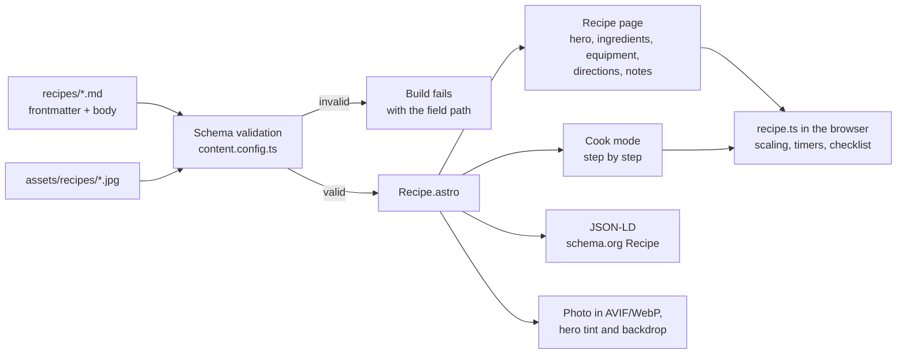
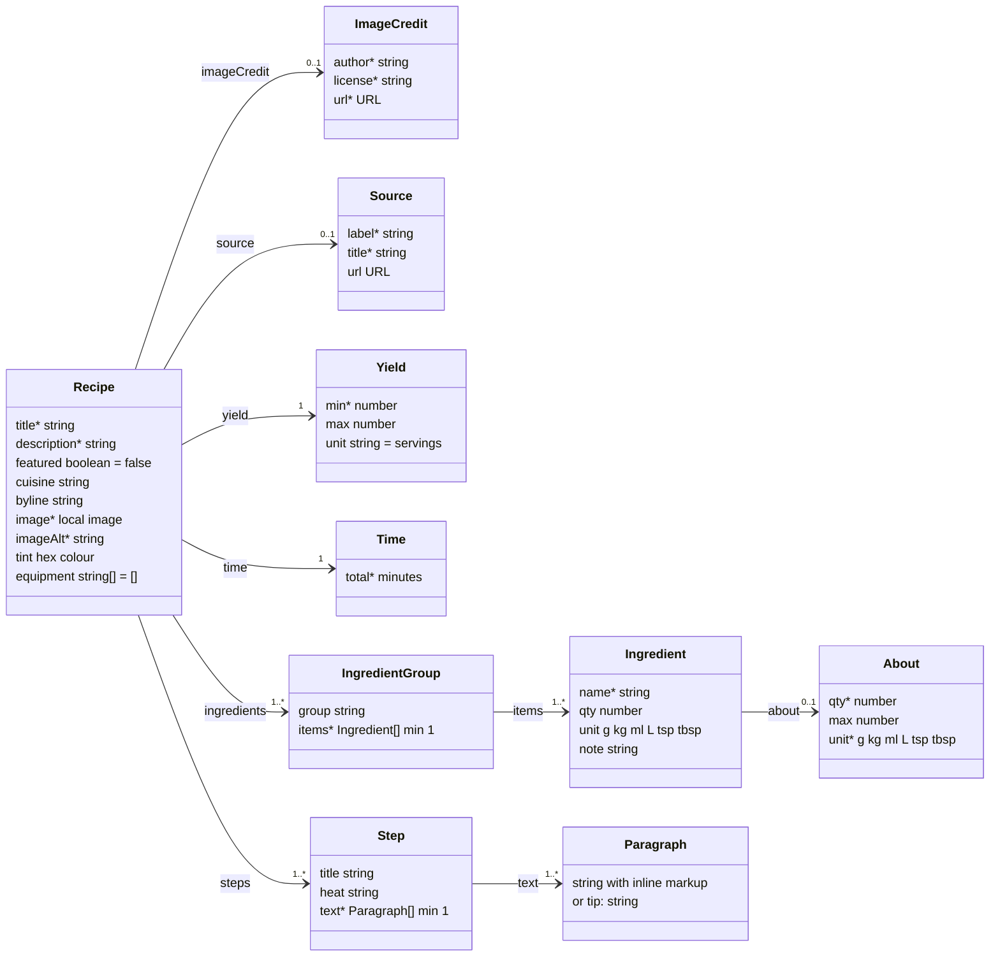
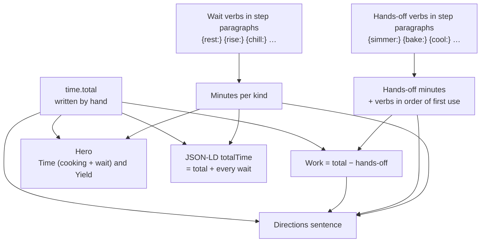

# The recipe model

What a soowee recipe contains, how each part is defined, what is required, and what the site derives from it.

The source of truth is the schema in [`src/content.config.ts`](../src/content.config.ts); this document explains it. A test (`src/lib/docs.test.ts`) fails when a schema field is missing here, so the two cannot quietly drift apart.

- [Overview](#overview)
- [Data model](#data-model)
- [Field reference](#field-reference)
- [Inline markup in steps](#inline-markup-in-steps)
- [Time](#time)
- [Scaling](#scaling)
- [Validation rules](#validation-rules)
- [Notes in the Markdown body](#notes-in-the-markdown-body)
- [Writing conventions](#writing-conventions)
- [Examples](#examples)
- [Open decisions](#open-decisions)

## Overview

One recipe is one Markdown file in `src/content/recipes/`. The file name is the URL: `tiramisu.md` becomes `/tiramisu/`.

- **Frontmatter** (the YAML between the `---` lines) holds the structured data: everything that is scaled, timed, validated or exported.
- **Body** (the Markdown after the frontmatter) holds the notes under three fixed headings: chef’s notes, allergens and, optionally, the source. It is shown below the directions; its text is free, only the headings are checked.



The home page (`/`) lists every recipe with search. The recipe with `featured: true` leads it as a large card; at most one recipe can be featured (the build fails otherwise), and with none the page simply starts with the list.

## Data model

Fields marked `*` are required. Everything else is optional.



## Field reference

### Recipe

| Field | Type | Required | Default | Rules | Shown |
|---|---|---|---|---|---|
| `title` | text | yes | | | Hero heading, browser tab, cook mode, JSON-LD `name` |
| `description` | text | yes | | One or two sentences | Lede under the hero, home page list (cut to 3 lines on phones), meta description, social preview, JSON-LD |
| `featured` | true/false | no | `false` | At most one recipe | Shown large at the top of the home page, instead of in its list (it joins the list only as a search result) |
| `cuisine` | text | no | | e.g. `Italian`, `British` | Small label above the title, JSON-LD `recipeCuisine` |
| `byline` | text | no | | Currently used for origin: `Adapted from Vincenzo’s Plate` | Under the title |
| `image` | path | yes | | Relative path to a local image; by convention in `src/assets/recipes/` | Hero photo (AVIF/WebP, 480–2560 px), source-card thumbnail, social preview; the hero colour and the blurred backdrop are computed from it |
| `imageAlt` | text | yes | | Describe what is in the photo | Alt text of the hero photo |
| `imageCredit` | object | no | | See [Image credit](#image-credit) | Footer: “Photo: author, license” |
| `tint` | text | no | from the photo | `#rrggbb` | Overrides the hero colour |
| `source` | object | no | | See [Source](#source) | Card in the hero, a link if it has a `url` |
| `yield` | object | yes | | See [Yield](#yield) | Hero, ingredients header, JSON-LD; scales |
| `time` | object | yes | | See [Time](#time) | Hero, directions header, JSON-LD |
| `ingredients` | list of groups | yes | | At least one group | Ingredients list, cook-mode ingredients tab, JSON-LD |
| `equipment` | list of text | no | `[]` | One item per line: `Fine-mesh sieve, for dusting cocoa` | Equipment section; hidden when empty |
| `steps` | list | yes | | At least one step | Directions, cook mode, JSON-LD |

### Image credit

All three fields are required when `imageCredit` is present. Photos are licensed images (Unsplash, Wikimedia Commons), never the original recipe author’s.

| Field | Type | Rules |
|---|---|---|
| `author` | text | As the licence asks for it |
| `license` | text | e.g. `Unsplash License`, `CC BY-SA 4.0` |
| `url` | URL | The photo’s page, not the image file |

### Source

| Field | Type | Required | Rules |
|---|---|---|---|
| `label` | text | yes | Small caps line on the card, e.g. `Original recipe` |
| `title` | text | yes | e.g. `Vincenzo’s Plate: Authentic Tiramisu` |
| `url` | URL | no | Without it the card is not a link |

### Yield

| Field | Type | Required | Default | Rules |
|---|---|---|---|---|
| `min` | number | yes | | Positive |
| `max` | number | no | | For a range: `8–10 servings` |
| `unit` | text | no | `servings` | e.g. `pieces` |

### Ingredient groups

| Field | Type | Required | Rules |
|---|---|---|---|
| `group` | text | no | The part of the dish: `For the cream`. Leave out for a recipe with one group |
| `items` | list of ingredients | yes | At least one |

### Ingredient

Written as a YAML flow mapping, one per line: `- { qty: 750, unit: g, name: mascarpone }`.

| Field | Type | Required | Rules | Example |
|---|---|---|---|---|
| `name` | text | yes | What you shop for, name first. Steps refer to it by this name: see [Ingredient mentions](#ingredient-mentions) | `mascarpone`, `onion`, `mozzarella fior di latte` |
| `qty` | number | no | Positive. Leave out for “a pinch”, “to taste”, “for dusting” | `750`, `1.5` |
| `unit` | unit | no | One of `g`, `kg`, `ml`, `L`, `tsp`, `tbsp`. Leave out for counted things | `g` |
| `about` | object | no | Approximate weight or volume of something counted in pieces. See below | `{ qty: 150, unit: g }` |
| `note` | text | no | Size, cut, kind or use, shown after the name in a lighter tone. Does **not** scale | `medium, diced into small cubes` |

`about` exists because a weight written in `note` would not scale.

| Field | Type | Required | Rules |
|---|---|---|---|
| `qty` | number | yes | Positive |
| `max` | number | no | For a range; must be larger than `qty` |
| `unit` | unit | yes | Same list as `unit` above |

Rendered as `36 Savoiardi biscuits (about 300–360 g), ladyfingers, half for each layer`.

The units are metric only, by design. Imperial is an [open decision](#open-decisions).

### Step

| Field | Type | Required | Rules |
|---|---|---|---|
| `title` | text | no | Short, imperative: `Make the cream` |
| `heat` | text with inline markup | no | Oven or oil to get hot, e.g. `Preheat the **oven** to **180 °C**`. Shown first in the step with a thermometer icon and highlighted, so it is started in time |
| `text` | list of paragraphs | yes | At least one. A paragraph is either text with [inline markup](#inline-markup-in-steps) or a `tip`, written `- tip: …` |

A step needs at least one line that is not a tip (`heat` or a text paragraph), because cook mode lands on those lines.

## Inline markup in steps

Allowed in `heat`, step paragraphs and tips. Raw HTML is escaped, not rendered.

| Markup | Meaning | Rendered as | Scales | Counts towards |
|---|---|---|---|---|
| `{750 g mascarpone}`, `{6 eggs}` | An ingredient [measured out](#ingredient-mentions) at this point: amount, then the ingredient | `750 g` **mascarpone** | the amount | Its total in the list |
| `{cocoa powder}` | An ingredient used here, without an amount | **cocoa powder** | | |
| `{300 ml}`, `{2 tbsp}`, `{6}` | An amount not linked to an ingredient: an intermediate preparation (“{300 ml} ragù”) or a portion measured out earlier | `300 ml` | yes | |
| `**180 °C**` | Emphasis that is not an ingredient: the temperature in a `heat` line | Bold | | |
| `{timer:20m}`, `{timer:5-10m}` | Something the cook does or checks on | Tappable timer, label `5–10 minutes`; a range rings at its lower bound | | Work |
| `{simmer:1h}`, `{bake:30m}`, `{cool:15-20m}` … | Hands-off time while cooking: the dish works on its own, the cook stays in the process. One verb per kind, see [Hands-off verbs](#hands-off-verbs) | Tappable timer, like `{timer:}` | | Cooking time, not work |
| `{rest:1h}`, `{rise:2h}`, `{marinate:4h}` | A wait the cook can walk away from, see [Wait verbs](#wait-verbs) | Tappable timer, like `{timer:}` | | The wait, outside the cooking time |
| `{chill:8h}`, `{freeze:6h}` | A wait in the fridge or freezer, at least this long | Plain text `8 hours`, not a timer | | The wait, outside the cooking time |
| `tip: …` | A callout between paragraphs | Bulb icon; “Tip:” for screen readers | | |

Durations are written as `45s`, `20m`, `1h`, `1h30m` or a range `5-10m`. The label is generated (“1 hour 30 minutes”), so durations read the same everywhere; write the sentence around it: “bake for {bake:10m} more”. Amount units must be from the unit list, and a token that is not in the lists (`{wait:1h}`, `{steam:5m}`) fails the build instead of being printed raw.

Use `{timer:}` when the cook is busy (stirring, frying, whisking) and a hands-off verb when they are free to do something else. A bake the cook has to watch closely is still `{bake:}`; the difference is only whether the time counts as work.

Only step paragraphs count towards time: a duration inside `heat` or a tip is shown, and validated, but not counted.

### Ingredient mentions

Steps name the ingredients of the list with `{…}`, so the build can check them against the list. Bold is only for emphasis, and an ingredient written in bold fails the build.

- **Which ingredient.** The text in the braces is the ingredient’s `name`, or whole words of it that fit only one ingredient: `{Provolone}` for `Provolone Piccante`, `{celery}` for `celery stick`. A plural is fine: `{2 lemons}` for `lemon`. A complete name wins over a partial one, so `{water}` is `water`, not `sparkling water`. Where a recipe has two salts, `{salt}` fails and the full name is needed. Lines with the same name in different groups are one ingredient.
- **Every ingredient is used.** Each ingredient of the list is mentioned at least once in a step paragraph or a `heat` line.
- **Measured once.** An amount inside the braces, `{250 g ground beef}`, is taken from the list at this point. For each ingredient these amounts add up exactly to its amount in the list (lines of the same name added together; `g` and `kg`, `ml` and `L` converted, spoons and counts only with themselves). A portion measured out earlier is mentioned with the amount on its own: “Grate {80 g Pecorino Romano} and set {30 g} aside”, later “the reserved {30 g} {Pecorino Romano}”. An amount added to taste is still written in: “adjust with up to {3 g salt}”. An ingredient mentioned only without an amount is used whole at that point, “Add the {onion}”, so nothing is added up; that is also how an ingredient without `qty` (“a pinch”) is mentioned.
- **Tips stay plain.** Tips mention ingredients in plain text, without `{…}` or bold, and their amounts (`{20 g}`) scale but do not count.

The rendered page looks the same either way: the amount scales and the ingredient is bold. The rules are in [`src/lib/mentions.ts`](../src/lib/mentions.ts).

## Time

All times are whole minutes.

| Field under `time` | Required | Meaning |
|---|---|---|
| `total` | yes | The cooking time: start to finish of the cooking, **including** hands-off time (`{simmer:}`, `{bake:}` …) and **excluding** every wait (`{rest:}`, `{rise:}`, `{marinate:}`, `{chill:}`, `{freeze:}`) |

`total` is the only time written by hand. Everything else is derived from the duration tokens in the step paragraphs, so the page cannot show times that contradict the method. There is no separate prep time: it would be a second, unchecked source for the same thing.

### The rule: cooking time, then the wait

A cook plans in that order: how long does it take to make, and how long until we can eat? So every recipe splits its time the same way:

- **Cooking time** is everything the cook is in the process for: the work at the counter and the hands-off time in between (a ragù simmering, a lasagna baking, a cake cooling before it is iced). The cook can step away for a minute, but not leave.
- **The wait** is time the cook can walk away from: a batter resting, a dough rising, meat marinating, a tiramisu setting in the fridge. It can be in the middle of the method (crêpe batter) or at the end (tiramisu).

**Choosing the verb** decides which side a duration lands on. Ask: *can the cook leave the kitchen, or go to bed?* Yes → a wait verb. No → a hands-off verb, or `{timer:}` if they are busy.

### Terms

One vocabulary on every recipe:

| Term | Where | Meaning |
|---|---|---|
| **Time** | Hero: the cooking time, with the wait on a line under it (“30 min”, “+ 8 hr chilling”) | `time.total`, then the sum of the waits |
| **In total** | Directions sentence (“4 hr 30 min in total”) | The cooking time, when the recipe has no wait. With a wait it reads “of cooking”, since it is not the whole time |
| **Work** | Directions sentence (“1 hr 25 min of work”) | The part of the cooking time the cook is busy: total minus hands-off time |
| **Hands-off** | This document only | Time the dish works on its own while the cook stays in the process: the verbs below. Named by what happens (“simmering, baking”), never by this word on the page |
| **Wait** | This document only | Time the cook can walk away from, on top of the cooking time. Named by what happens (“resting”, “in the fridge”) |

The hero shows exactly two facts on every recipe, **Time** and **Yield**. The wait sits on its own line under the cooking time rather than in a third column: a third column wrapped onto a second row on narrow phones, and a line of its own reads second, after the cooking time, and never widens the row. A recipe without a wait shows only the cooking time. This follows the “25 minutes, plus 4 hours’ chilling” convention of NYT Cooking and America’s Test Kitchen, rather than a single total that hides how much of it is waiting.

### Hands-off verbs

Part of the cooking time. Each verb is a timer. The word in the second column is used in the Directions sentence. To add one, add it to `HANDS_OFF` in [`src/lib/inline.ts`](../src/lib/inline.ts) and a row here (a test checks both).

| Token | In the sentence | Use for |
|---|---|---|
| `{simmer:}` | simmering | A sauce, stew or ragù cooking on its own |
| `{bake:}` | baking | Anything in the oven that is not a roast: lasagna, bread, cakes |
| `{roast:}` | roasting | Meat and vegetables in the oven |
| `{cool:}` | cooling | Cooling or settling at room temperature before the next step or before slicing: a cake before icing, a lasagna before it is cut |
| `{dry:}` | drying | Steam-drying, air-drying: parboiled chips on a rack |
| `{drain:}` | draining | Liquid running off: mozzarella, yoghurt, salted vegetables |
| `{soak:}` | soaking | In water, as part of the method: potatoes, short soaks |

### Wait verbs

Outside the cooking time. The word in the second column is used in the hero (“+ 1 hr resting”) and, for waits without a place, in the Directions sentence (“1 hr of resting”). To add one, add it to `WAITS` in [`src/lib/inline.ts`](../src/lib/inline.ts) and a row here (a test checks both).

| Token | In the hero | Use for |
|---|---|---|
| `{rest:}` | resting | A batter or dough left to relax: crêpes, pastry. A timer |
| `{rise:}` | rising | Yeast dough. A timer |
| `{marinate:}` | marinating | In a marinade. A timer |
| `{chill:}` | chilling | In the fridge: setting a tiramisu or panna cotta, chilling a dough. Plain text, not a timer |
| `{freeze:}` | freezing | In the freezer: ice cream, semifreddo. Plain text, not a timer |

The fridge and the freezer are named by their place in the Directions sentence, with “at least”, because longer is fine there:

| Token | In the sentence |
|---|---|
| `{chill:}` | in the fridge |
| `{freeze:}` | in the freezer |

Meat resting for a few minutes before carving is part of serving, not a wait: write it as `{cool:}` or a `{timer:}`.

### How the times are derived



The hero and the sentence are built by `heroTime` and `describeTime` in [`src/lib/time.ts`](../src/lib/time.ts), with a unit test for every case below. JSON-LD is the one place where the waits are added to the cooking time, because schema.org’s `totalTime` means “until it can be served”.

### The Directions sentence

Generated, never written by hand. The numbers are bold.

| The recipe has | Hero | Directions sentence |
|---|---|---|
| Only work | 25 min | **25 min** from start to finish. |
| Hands-off time | 4 hr 30 min | **4 hr 30 min** in total: **1 hr 25 min** of work and **3 hr 5 min** of simmering, baking and cooling. |
| A wait | 50 min<br/>+ 1 hr resting | **50 min** of work, plus **1 hr** of resting. |
| Fridge time | 30 min<br/>+ 8 hr chilling | **30 min** of work, plus at least **8 hr** in the fridge. |
| Both | 45 min<br/>+ 4 hr chilling | **45 min** of cooking: **30 min** of work and **15 min** of cooling, plus at least **4 hr** in the fridge. |
| Several waits | 40 min<br/>+ 8 hr rising and chilling | **40 min** of work, plus **2 hr** of rising and at least **6 hr** in the fridge. |

Rules:

- The verbs are listed in the order they first appear in the method, each once, joined as “a, b and c”. Waits follow the same rule, except that the fridge and then the freezer always come last.
- Hands-off time gets its own number instead of “the rest is …”, so the reader can see that work and hands-off time add up to the cooking time.
- The waits are joined with “plus”, never “then”: a wait can sit in the middle of the method.
- The hero adds the waits into one number, named by their verbs: “+ 8 hr rising and chilling”.
- “At least” is used only for the fridge and freezer, where longer is fine. A bake should not run longer.
- A day or more is written in days: `1 day 2 hr`.

How the sums are made:

- A range counts at its **lower bound**: `{bake:20-25m}` adds 20 minutes, `{chill:8-12h}` reads “8–12 hours” but adds 8 hours. Write `time.total` with the same lower bounds, or the work time comes out too long. The hero’s wait is the lower bound too: “+ 8 hr chilling” means at least 8 hours.
- The sums are made in seconds and rounded to whole minutes once, so hands-off time shorter than 30 seconds in total counts as none.

Known simplification: work done *during* hands-off time (making the béchamel while the ragù simmers) is not counted as work. Work is the time the recipe needs the cook at the counter, not every minute they spend in the kitchen.

## Scaling

The reader can scale a recipe to ½×, 1×, 1½×, 2×, 3× or 4×. The choice and the ticked-off ingredients survive a reload for the visit (session storage). Running timers survive a reload too, and saved recipes and the light/dark choice are kept across visits (local storage).

| Scales | Does not scale |
|---|---|
| Ingredient `qty` | `note` |
| `about.qty` and `about.max` | `equipment` |
| `{amount}` in steps, `heat` and tips | Numbers written as plain text (“1–2 seconds”, “180 °C”) |
| `yield` | Times |

Every scaled value is rounded independently:

- `g` and `ml`: whole numbers, to the nearest 5 from 100 up (750 × 1.5 = 1125), and one decimal below 1 (1 g at ½× reads 0.5 g).
- `kg` and `L`: up to two decimals, trailing zeros dropped.
- Everything else (counts, `tsp`, `tbsp`, yield): the nearest of ⅛, ¼, ⅓, ⅜, ½, ⅝, ⅔, ¾ and ⅞; anything that would round to nothing reads ⅛.

So a split amount can drift from its total at some scales: 15 g + 15 g of a 30 g ingredient reads 8 g + 8 g at ½×.

## Validation rules

The build fails in two places, and `pnpm test` adds one more check.

**Schema validation**, with the recipe file and the field path, when:

- a required field is missing, or a value has the wrong type;
- a key is not part of the schema, at any level: a misspelt `cusine:` or an invented `time.prep` fails instead of being dropped;
- an ingredient or `about` `unit` is not in the unit list;
- `qty`, `about.qty`, `about.max` or a `yield` number is zero or negative, or `about.max` is not larger than `about.qty`;
- `time.total` is not a positive whole number of minutes, or the hands-off verbs add up to `time.total` or more (there would be no work left);
- any step text (`heat`, a paragraph or a tip) has a malformed duration (`{chill:overnight}`), an unknown token (`{wait:1h}`) or a malformed amount (`{25gr}`); the path points to the exact line, e.g. `steps.3.text.1`;
- an [ingredient mention](#ingredient-mentions) fits no ingredient or more than one (`{2 cups}` fits none), an ingredient is never mentioned, the measured amounts of an ingredient do not add up to the list, an ingredient is written in bold, or a tip uses `{…}` for an ingredient;
- a step has only tips and no `heat`;
- `tint` is not a `#rrggbb` colour, or a URL is not a URL;
- the `image` file does not exist.

**Rendering the page** runs the token checks again on the same text, so in practice it only fails if schema validation was bypassed.

**`pnpm test`** also checks the [notes](#notes-in-the-markdown-body): only the fixed headings, in order, with the required ones present (`src/lib/notes.test.ts`).

Not checked, so it is up to the author:

- that `yield.max` is larger than `yield.min`;
- that an amount written outside the braces, or for an intermediate preparation, is right;
- that `time.total` matches the method.

## Notes in the Markdown body

Markdown after the frontmatter, shown as a “Notes” section below the directions. It is not part of the scaled data and not in JSON-LD, but its sections are fixed so every recipe reads the same way: only these headings, in this order, each at most once.

| Heading | Required | Content |
|---|---|---|
| `## Chef’s Notes` | yes | Labelled bullets: make ahead, store, swap, serve. See [Chef’s Notes](#chefs-notes) |
| `## Allergens` | yes | One bullet per allergen from the EU list, with where it comes from, plus a swap if there is one. See [Allergens](#allergens) |
| `## Source` | no | “Adapted from [title](url).”, plus a video link if there is one. Leave it out for your own recipes |

No other headings: storage, variations and serving suggestions are bullets in Chef’s Notes, not sections of their own, so the page stays short. `src/lib/notes.test.ts` enforces this.

## Writing conventions

### The reader

A home cook with basic craft who wants a restaurant-level result, not a shortcut. They own a scale and a thermometer, know how to dice an onion and what a simmer is, and will follow a two-hour ragù if it is worth it. So a recipe:

- explains the *why* of the steps that make the difference (browning in batches, a cold batter), never the basics;
- is precise where precision decides the result: weights, temperatures, a probe reading, a sensory cue;
- says what to buy when it matters (fior di latte, not bufala);
- stays lean. Every line has to earn its place, because a long recipe is harder to cook from, on the page and in cook mode. Guidance for someone cooking a dish for the first time is a separate idea in the [open decisions](#open-decisions), not a reason to add tips.

### Detail budget

| Part | Budget |
|---|---|
| `description` | One or two sentences: what the dish is and what makes this version worth it. Mention a commitment the reader must plan for (“Made a day ahead”). Lead with what helps someone choose: phones show only the first 3 lines on the home page. Not a list of every component, no filler (“featuring”, “delicious”) |
| Step | One phase of the dish, about 6 paragraphs at most. Split a longer one where the cook could pause: “Brown the meat”, then “Simmer the ragù” |
| Tip | At most two in a step, and most steps have none or one. A tip earns its place only if it adds one of: the *why* behind the step, how to tell it is going wrong, a choice at that point (a swap, what to buy), or a safety note. It never repeats its step |
| Equipment | Only what has a size or spec that matters, or what is not in every kitchen. Not knife, board, spoon, bowl or kitchen paper |
| Chef’s Notes | One bullet per label, see [Chef’s Notes](#chefs-notes) |

Planning (“start here”, “while the ragù simmers”) goes in the step text as an instruction, not in a tip. A tip about the oven or the oil goes in that step’s `heat` line.

### Ingredients

- `name` comes first, qualifiers go in `note`: `onion` + `medium, diced into small cubes`, not `medium diced onion`.
- An ingredient appears at most once in a group. If it is used several times within the group, write the total and say how it splits in the `note`: `in total: 1 g with the vegetables, 8 g with the meat`. If it is used by several groups, each group lists its own amount.
- Use the measure the cook would reach for. Grams for what you weigh, `ml` or `L` for liquids, a count for eggs and other pieces. A spoon (`tsp`, `tbsp`, always level) where it is easier than the scale and precise enough: small amounts such as baking powder, spices, a little oil or lemon juice, and a ratio the cook can remember, like one tablespoon of sugar per egg. Grams where a spoon would be too rough: flour and sugar in baking, salt in a brine or a cure. Below 5 g, write a spoon or leave `qty` out and write `a pinch` in `note`, since few kitchen scales read that low.
- Something counted in pieces gets an `about` weight when its size changes the result: `1 onion (about 150 g)`.
- Quote a `note` that contains a comma: `note: "large, separated"`. Unquoted, YAML cuts the note at the comma and the rest is silently dropped.

### Steps and tips

- Mention every ingredient from the list with `{…}` in the step where it is used, every time, with its amount where it is measured out: see [Ingredient mentions](#ingredient-mentions). Intermediate preparations (egg whites, the cream, the ragù), the oven and equipment are plain text. Tips mention ingredients in plain text.
- Sensory cues next to times: “until pale, thick and creamy”, not only “for 5 minutes”.
- An amount that should change when the recipe is scaled is an `{amount}`, never plain text: “spread {300 ml} ragù”, not “about 300 ml of ragù”.

### Equipment

- Every dish, tin or pan that a bake or a set dessert takes its shape from has its inside size: `Baking dish, 30 × 20 cm`. A pot gets its volume where it matters: `Pot, heavy-bottomed, 5 L`.
- Settings belong in the step, not in the list: the oven mode goes in the `heat` line.
- In the order of first use.

### Chef’s Notes

Bullets with a bold label, only these labels, in this order, each at most once and each optional. At least one.

| Label | Content |
|---|---|
| `**Make ahead:**` | What can be done in advance, how far ahead, and how to finish it |
| `**Store:**` | Where and for how long: “keeps 3 days in the fridge”, plus how to reheat |
| `**Swap:**` | Substitutions and authentic variations: a different cheese, Marsala in a tiramisu |
| `**Serve:**` | What goes with it |

Technique belongs in the step it concerns, as a tip if the step does not already say it.

### Allergens

One bullet per allergen, named as in the EU list of 14, in this order: **Gluten**, **Crustaceans**, **Egg**, **Fish**, **Peanuts**, **Soy**, **Milk**, **Tree nuts**, **Celery**, **Mustard**, **Sesame**, **Sulphites**, **Lupin**, **Molluscs**. Each lists the ingredients it comes from, plus a swap in one sentence if there is one: `- **Gluten:** flour and beer. Use gluten-free flour and beer.` Nothing else goes here: alcohol, for example, is a swap in Chef’s Notes, not an allergen.

### Text

- Typographic apostrophes and quotes: `Chef’s`, `Vincenzo’s`.
- An en dash for ranges in plain text, as the generated labels have: `2–3 minutes`, `60–63 °C`.
- Every paragraph and tip ends with a full stop.
- English, metric units, `°C`, with a space before the unit: `180 °C`, `1.5 cm`.

## Examples

Minimal valid recipe:

```yaml
---
title: Toast
description: Crisp bread with butter.
image: ../../assets/recipes/toast.jpg
imageAlt: Two slices of buttered toast on a plate
yield:
  min: 1
time:
  total: 5
ingredients:
  - items:
      - { qty: 2, name: slices of bread }
      - { qty: 10, unit: g, name: butter }
steps:
  - text:
      - Toast {2 slices of bread} for {timer:2-3m}, until golden, and spread with {10 g butter}.
---
```

For a full recipe with groups, `about`, `heat`, tips, hands-off verbs and a wait (`{chill:}`), see [`lasagna.md`](../src/content/recipes/lasagna.md) and [`tiramisu.md`](../src/content/recipes/tiramisu.md).

## Open decisions

Not decided yet; listed so they are not lost. None of them exists in the code today.

| Topic | Today | Option |
|---|---|---|
| Unit system | Metric only | Metric stays the default. A reader toggle to imperial later needs conversions for `g`/`ml` and a decision on `tsp`/`tbsp` (already shared) and on oven temperatures, which are plain text today |
| `byline` | Used for the recipe’s origin (“Adapted from …”) | Decide whether it is the author, the origin, or both, and whether origin moves to `source` |
| Size and preparation | Both in `note`: `medium, diced into small cubes` | Separate `size` and `prep` fields for a consistent order |
| Time before starting | A marinade or a rise is a wait (`{marinate:}`, `{rise:}`); `{soak:}` is still part of the cooking time | Overnight soaking of pulses happens before the cook starts. It would need a wait verb for long soaks, or the sentence could open with it: “Start the night before: at least **12 hr** of soaking, then …” |
| Heat | Free text; the temperature is bold text | A structured temperature (`temp: 180`), needed for a °F toggle and a preheat timer |
| First-time guidance | One level of detail for everyone: a home cook with basic craft who wants a restaurant-level result | Extra guidance marked in the recipe (more cues, the *why*, common mistakes), shown to a reader cooking the dish for the first time and hideable by everyone else. It would keep the default recipe lean instead of adding tips for every reader. Backlog idea, to explore later |
